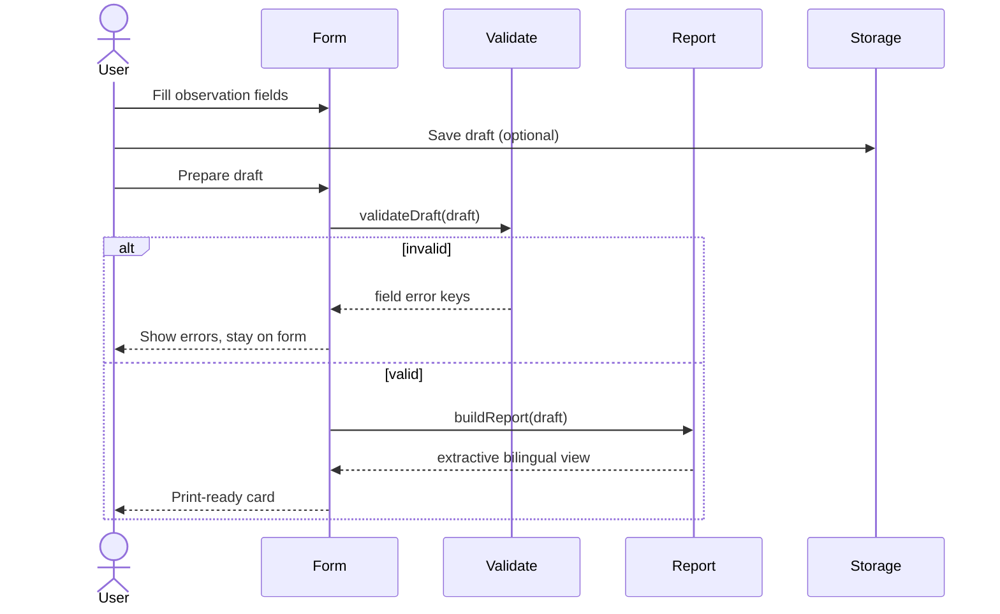

# Design Document

## Overview

Safra is a single-page, client-only React application. A language provider wraps a guided form and a print-ready preview. Validation and report generation are pure TypeScript functions, which keeps medical-safety rules testable without a browser.

The visual design resurrects a mid-century Yellow Card: an ink-green blotter background and a centered, slightly aged yellow card with a double crimson rule, a "DRAFT — NOT AN OFFICIAL REPORT" stamp, and bilingual typography (Libre Baskerville for Latin titles, Noto Naskh Arabic for Arabic titles, IBM Plex Sans / IBM Plex Sans Arabic for UI). The look should feel archival and serious, not cartoon Halloween.

## Architecture

```text
LocaleProvider
  App
    Header (title, language toggle)
    Persistent Disclaimer (EPVC links)
    ReportForm  --or--  ReportPreview
      domain/validation.ts
      domain/report.ts
      domain/storage.ts
      domain/epvc.ts
```

- `src/domain/epvc.ts` is the only source for official names and URLs.
- `src/domain/validation.ts` returns per-field error keys (message ids), never invented prose.
- `src/domain/report.ts` maps a valid `ReportDraft` to a structured bilingual `ReportView` of labels and raw field values. It must not add sentences the user did not type.
- `src/i18n/messages.ts` holds all UI strings for `en` and `ar`.
- `src/domain/storage.ts` reads and writes a versioned localStorage key.

## Data model

```ts
type ReporterType = 'patient' | 'caregiver' | 'pharmacist' | 'other_hcp'
type Severity = 'non_serious' | 'serious' | 'unknown'
type Outcome =
  | 'recovering'
  | 'recovered'
  | 'not_recovered'
  | 'recovered_with_sequelae'
  | 'fatal'
  | 'unknown'

interface ReportDraft {
  reporterType: ReporterType | ''
  medicineName: string
  medicineStrength: string
  medicineNotes: string
  concomitantMedicines: string
  reaction: string
  startedOn: string          // YYYY-MM-DD or empty
  startDateUnknown: boolean
  stoppedOn: string
  stillOngoing: boolean
  severity: Severity | ''
  outcome: Outcome | ''
}
```

No identifier fields are included on purpose.

## Data flow

1. The user edits the form. Changes update React state.
2. "Save draft" writes the current state to localStorage.
3. "Prepare draft" runs `validateDraft`. On failure, field errors are shown and preview stays closed. On success, the preview renders `buildReport(draft)`.
4. Print uses `window.print()` and CSS `@media print` to hide chrome.
5. Language toggles `document.documentElement.lang` and `dir`, and persists the locale.



## Error handling

- Validation errors are shown next to the relevant fields, using locale strings.
- Corrupted localStorage data is ignored and treated as an empty draft.
- Official links are static. If a URL ever changes, update `src/domain/epvc.ts` only after re-verifying the live official page.

## Testing strategy

- Vitest unit tests for `validateDraft` (required fields, date order, unknown-date flag).
- Vitest unit tests for `buildReport` (extractive values, bilingual labels, disclaimer and EPVC URL always present, no causal wording added).
- Locale key-parity test (and `scripts/check-i18n-keys.mjs`) so every English key exists in Arabic and vice versa.
- `npm run build` (tsc + Vite) must pass.

## Medical-safety design constraints

- Extractive report generation only.
- Disclaimer visible on screen and in print.
- No network submission path.
- Fictional sample data only.
